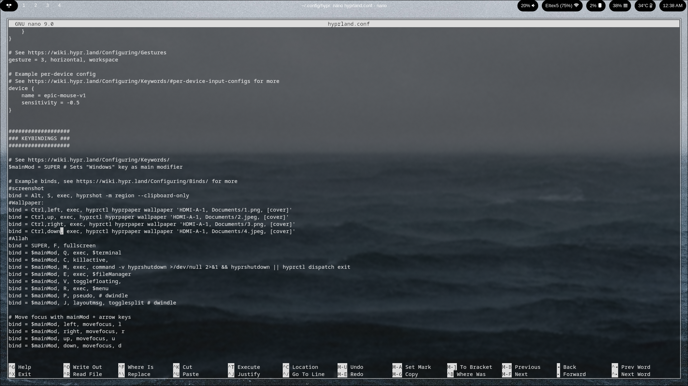
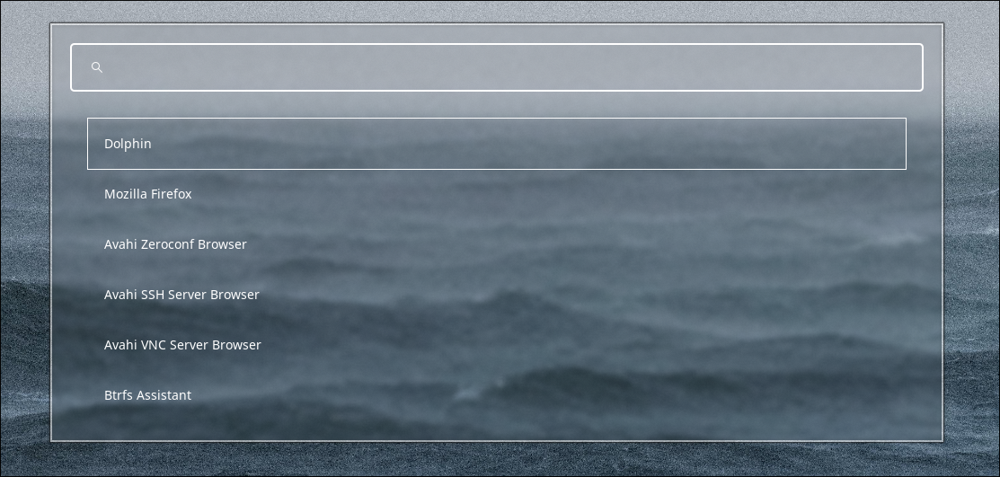
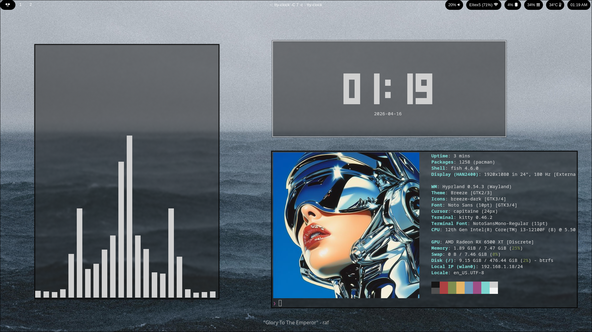

# Black-White

> Минималистичный монохромный (чёрно-белый) сетап для **Hyprland** на Lua-конфиге.

Конфиги Hyprland, Waybar и Wofi, чёрно-белая тема, готовый установщик.

> ⚠️ **Нужен Hyprland 0.55 или новее.** Начиная с этой версии конфиг пишется на Lua (`hyprland.lua`), старый `hyprland.conf` больше не используется. Проверить версию: `hyprctl version`.

---

## 📸 Превью

<table border="0">
  <tr>
    <td align="center">
      
      <br><b>Чистый рабочий стол</b>
    </td>
    <td align="center">
      
      <br><b>Конфиг</b>
    </td>
  </tr>
  <tr>
    <td align="center">
      
      <br><b>Лаунчер (wofi)</b>
    </td>
    <td align="center">
      
      <br><b>Waybar и статус системы</b>
    </td>
  </tr>
</table>

---

## 📦 Что внутри

```
Black-White/
├── hypr/
│   ├── hyprland.lua      # основной конфиг Hyprland (Lua)
│   └── hyprpaper.conf    # обои при запуске
├── waybar/
│   ├── config            # модули панели
│   └── style.css         # стиль панели
├── mako/
│   └── config            # чёрно-белая тема уведомлений
├── wofi/
│   ├── config            # настройки лаунчера
│   └── style.css         # стиль лаунчера
├── temporal/             # скриншоты (они же обои по умолчанию)
├── scripts/
│   └── set-wallpaper.sh  # переключение обоев
└── install.sh            # установщик
```

---

## 🧰 Зависимости

Установщик поддерживает **Arch Linux** и **Fedora Linux**. Он сам устанавливает Hyprland, Lua-конфиг и приложения, используемые этим сетапом.

| Компонент | Назначение |
|---|---|
| `hyprland` | Wayland-композитор |
| `hyprpaper` | Обои |
| `waybar` | Панель |
| `wofi` | Лаунчер |
| `mako` | Демон уведомлений с чёрным фоном и белым текстом |
| `kitty`, `dolphin` | Терминал и файловый менеджер |
| PipeWire, WirePlumber | Звук |
| `hyprshot` | Скриншоты |
| `blueman`, BlueZ | Bluetooth |
| NetworkManager, `nmtui` | Сеть |
| `brightnessctl`, `playerctl`, `pavucontrol` | Яркость, мультимедиа и звук |
| Roboto, Font Awesome | Шрифты и иконки |

### Arch Linux

Используется `pacman`. Если `hyprshot` отсутствует в репозитории, установщик попробует найти `yay` или `paru` и установить его из AUR.

### Fedora Linux

Используется `dnf`. Для актуального Hyprland с Lua-конфигурацией установщик подключает сторонний COPR `nett00n/hyprland`, а остальные приложения устанавливает из репозиториев Fedora. COPR — сторонний репозиторий, не официальный репозиторий Fedora.

---

## 🚀 Установка

```bash
git clone https://github.com/nunofficial/Black-White.git
cd Black-White
chmod +x install.sh
./install.sh
```

После запуска установщик спросит:

```text
1) Arch Linux
2) Fedora Linux
0) Выход
```

Выбери `1` или `2`. Установщик проверит наличие соответствующего пакетного менеджера, покажет выбранную систему и запросит подтверждение перед изменениями.

### Что делает установщик

1. Устанавливает Hyprland и зависимости для выбранного дистрибутива.
2. Для Fedora подключает COPR `nett00n/hyprland`, чтобы получить достаточно новую версию Hyprland с Lua.
3. Устанавливает Mako и его чёрно-белую тему; Mako запускается автоматически при старте Hyprland.
4. При необходимости предлагает включить Bluetooth и NetworkManager.
5. Делает резервные копии существующих `~/.config/hypr`, `waybar`, `wofi` и `mako`.
6. Копирует конфигурации и скрипт смены обоев.
7. Копирует обои в `~/Documents/wallpapers`, не перезаписывая уже существующие картинки.

**Установщик не удаляет KDE Plasma или GNOME и не меняет текущий дисплейный менеджер.** Hyprland устанавливается как отдельная сессия. После установки выйди из KDE и выбери Hyprland на экране входа.

Запускай скрипт обычным пользователем, не через `sudo`: он сам запросит права администратора только для системных операций.

---

## ⚙️ Первичная настройка (важно!)

### 1. Монитор

Hyprland автоматически определяет подключённые мониторы. В конфиге нет принудительного разрешения `1920x1080@180`, поэтому он не должен ломаться на ноутбуках или мониторах с другой частотой.

Посмотреть имена и режимы:

```bash
hyprctl monitors
```

Если захочешь задать монитор вручную, добавь `hl.monitor({...})` в начало `~/.config/hypr/hyprland.lua`, используя точное имя и режим из `hyprctl monitors`.

Обои используют пустое поле `monitor` как fallback — это позволяет применить их к монитору независимо от его имени.

### 2. Раскладка клавиатуры

По умолчанию `us,kz`, переключение **Alt + Shift**. Меняется здесь:

```lua
kb_layout  = "us,kz",
kb_options = "grp:alt_shift_toggle",
```

Например, для английской и русской раскладок: `kb_layout = "us,ru"`.

### 3. Программы по умолчанию

В начале `hyprland.lua`:

```lua
local terminal    = "kitty"
local fileManager = "dolphin"
local menu        = "wofi --show drun"
```

---

## ⌨️ Горячие клавиши

`SUPER` это клавиша Windows.

### Основные

| Клавиши | Действие |
|---|---|
| `SUPER + Q` | Открыть терминал (kitty) |
| `SUPER + C` | Закрыть окно |
| `SUPER + R` | Лаунчер приложений (wofi) |
| `SUPER + E` | Файловый менеджер |
| `SUPER + F` | Полноэкранный режим |
| `SUPER + V` | Плавающее / тайловое окно |
| `SUPER + P` | Pseudo-режим (dwindle) |
| `SUPER + J` | Сменить направление разделения (dwindle) |
| `SUPER + M` | Выйти из Hyprland |
| `ALT + S` | Скриншот области в буфер обмена |

### Окна и воркспейсы

| Клавиши | Действие |
|---|---|
| `SUPER + ← ↑ → ↓` | Фокус на соседнее окно |
| `SUPER + 1…0` | Перейти на воркспейс 1–10 |
| `SUPER + SHIFT + 1…0` | Перенести окно на воркспейс 1–10 |
| `SUPER + S` | Показать / скрыть scratchpad |
| `SUPER + SHIFT + S` | Отправить окно в scratchpad |
| `SUPER + колесо мыши` | Листать воркспейсы |
| `SUPER + ЛКМ` (зажать) | Перетащить окно |
| `SUPER + ПКМ` (зажать) | Изменить размер окна |

### Обои

| Клавиши | Файл |
|---|---|
| `SUPER + CTRL + ←` | `~/Documents/wallpapers/1.png` |
| `SUPER + CTRL + ↑` | `~/Documents/wallpapers/2.png` |
| `SUPER + CTRL + →` | `~/Documents/wallpapers/3.png` |
| `SUPER + CTRL + ↓` | `~/Documents/wallpapers/4.png` |

### Мультимедиа

Кнопки громкости, яркости, mute и управления плеером (`XF86…`) работают из коробки через `wpctl`, `brightnessctl` и `playerctl`.

---

## 📸 Скриншоты

`ALT + S` выделяешь область мышкой, она копируется в **буфер обмена** (вставляется через `Ctrl + V`). В файл не сохраняется.

Чтобы сохранять в файл, замени бинд в `hyprland.lua`:

```lua
hl.bind("ALT + S", hl.dsp.exec_cmd("hyprshot -m region -o ~/Pictures/Screenshots"))
```

Другие режимы `hyprshot`: `-m window` (окно), `-m output` (весь монитор), `-m active` (активное окно).

---

## 🖼️ Обои

Обои лежат в `~/Documents/wallpapers/`. Хоткеи `SUPER + CTRL + стрелки` переключают `1.png`–`4.png`.

**Использовать свои картинки:**
- положи их в `~/Documents/wallpapers/` под именами `1.png`–`4.png`, либо
- поменяй имена в `hyprland.lua`:
  ```lua
  hl.bind(mainMod .. " + CTRL + left", wallpaper("моя_картинка.png"))
  ```

**Обои при запуске** задаются в `~/.config/hypr/hyprpaper.conf`:
```
wallpaper {
    monitor =
    path = ~/Documents/wallpapers/1.png
    fit_mode = cover
}
```

Смена обоев по хоткею обновляет `hyprpaper.conf` и перезапускает hyprpaper, чтобы применить выбранную картинку. При следующем входе останется последняя выбранная картинка.

---

## ⏻ Меню питания

Справа от часов находится кнопка питания. Клик по ней раскрывает кнопки:

| Кнопка | Действие |
|---|---|
| Луна | Сон (`systemctl suspend`) |
| Стрелка выхода | Выйти из сессии (`loginctl terminate-user $USER`) |
| Круговая стрелка | Перезагрузка (`systemctl reboot`) |
| Power (при наведении краснеет) | Выключение (`systemctl poweroff`) |

Меню встроенное (`drawer` в Waybar), дополнительные пакеты не нужны. Настройка находится в `~/.config/waybar/config`, блок `group/power`, оформление в `style.css`.

---

## 🔵 Bluetooth

Клик по значку Bluetooth в Waybar открывает `blueman-manager`. Колонку или наушники достаточно **один раз** спарить:

1. Переведи устройство в режим сопряжения (мигающий индикатор), убедись, что оно не подключено к телефону.
2. В `blueman-manager` нажми **Search**, найди устройство, правой кнопкой → **Pair**, **Trust**, **Connect**.

Дальше устройство подключается автоматически при включении. Установщик предлагает включить службу `bluetooth`. Если адаптер не включается автоматически, проверь настройки Bluetooth в системе. Не нажимай `Remove`, это стирает сопряжение.

Если подключено, а звука нет: открой `pavucontrol` (клик по громкости), на вкладке **Output Devices** выбери устройство, а на вкладке **Configuration** поставь профиль **A2DP Sink**.

---

## 🩹 Решение проблем

**Fedora: Hyprland не появился на экране входа.** Убедись, что установка `hyprland` завершилась без ошибок, затем перезагрузи систему. Не удаляй SDDM/GDM: текущий дисплейный менеджер должен продолжить показывать доступные сессии.


**Сверху красная плашка «Your config has errors».**
В ней указана строка и ключ с ошибкой. Исправь её в `~/.config/hypr/hyprland.lua` и сохрани, конфиг применится сам. Проверка вручную: `hyprctl reload`.

**Конфиг вообще не применяется.**
Убедись, что лежит именно `~/.config/hypr/hyprland.lua`, а старый `hyprland.conf` убран или переименован. Проверь версию Hyprland (`hyprctl version`), нужна 0.55+.

**Нет обоев.**
- Имя монитора в `hyprpaper.conf` и `hyprland.lua` должно совпадать с выводом `hyprctl monitors`.
- Проверь, что файл существует: `ls ~/Documents/wallpapers`.
- Перезапусти: `pkill hyprpaper; hyprpaper &`.

**Не работает скриншот.**
Установи `hyprshot`. Запуск вручную для проверки: `hyprshot -m region --clipboard-only`.

**Не открывается Bluetooth по клику в Waybar.**
Установи `blueman`.

**Не работают иконки в Waybar.**
Установи шрифты: `ttf-font-awesome` и `ttf-roboto`.

---

## 🧩 Применение изменений

| Что изменил | Как применить |
|---|---|
| `hyprland.lua` | Сохранить, применится автоматически (или `hyprctl reload`) |
| `hyprpaper.conf` | `pkill hyprpaper; hyprpaper &` |
| Waybar | `pkill waybar; waybar &` |
| Wofi | Применяется при следующем запуске |

---

## 🙌 Благодарности

- [Hyprland](https://hypr.land) и его [wiki](https://wiki.hypr.land)
- [Waybar](https://github.com/Alexays/Waybar), [Wofi](https://hg.sr.ht/~scoopta/wofi), [hyprpaper](https://github.com/hyprwm/hyprpaper), [hyprshot](https://github.com/Gustash/Hyprshot)

---

**Если конфиг пригодился, поставь ⭐ репозиторию.**
